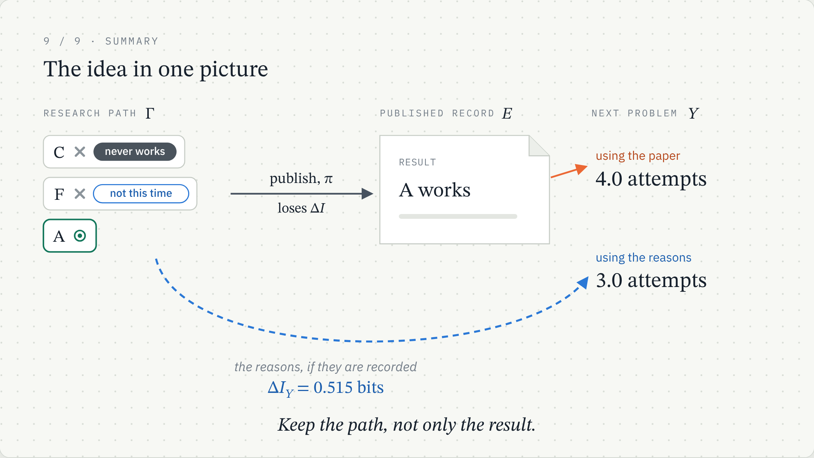
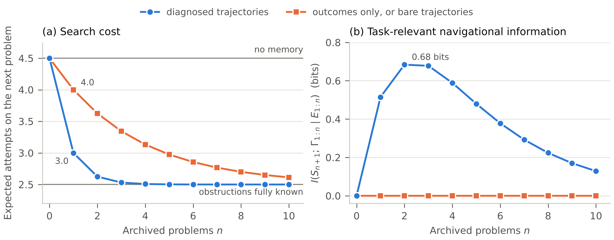

# Navigational Intelligence

Code for the paper

> **Navigational Intelligence: An Information-Theoretic Limit on What AI Can Learn from Published Research**
> Moein Sahraei, Department of Physics, Razi University, Kermanshah, Iran
> Submitted to *Neural Networks* (Elsevier), October 2026.
> Preliminary version: [doi:10.5281/zenodo.23257518](https://doi.org/10.5281/zenodo.23257518)



## The idea in brief

Machine-learning systems for science learn mostly from published results. The
process behind each result (dead ends, corrections, reasons an approach failed)
is rarely recorded. The paper treats a publication as a statistic of the
research trajectory and asks what is lost for learning.

* **Navigational intelligence** is the trajectory's conditional entropy given
  the published record, `ΔI = H(Γ | E)`. No system that sees only the record
  can reduce it.
* Its **task-relevant part**, `ΔI_Y = I(Y; Γ | E)`, equals the gap in optimal
  log-loss between predicting a downstream target `Y` from outcomes alone and
  from outcomes plus trajectories. It vanishes exactly when the record is a
  sufficient statistic for the task.

This repository contains the exactly solvable model in Section 5 of the paper,
which shows the difference between *bare* trajectories (the list of attempts)
and *diagnosed* trajectories (attempts labelled with the reason they failed).

## The model

* `K = 8` candidate approaches, of which `m = 4` are structurally obstructed
  (an unknown set). Each problem's solution is uniform over the viable ones.
* A researcher tries approaches in random order until one works.
* Published outcome: the solution only. Target: the solution of the next problem.

## Results (n = 1 archived problem)

| Quantity | Bare trajectories | Diagnosed trajectories |
|---|---|---|
| Navigational intelligence `ΔI` (bits) | 10.69 | 13.74 |
| Task-relevant part `ΔI_Y` (bits) | 0.000 | 0.515 |
| Expected attempts on the next problem | 4.0 | 3.0 |

With no memory at all the expected number of attempts is 4.5, and with
published outcomes only it is 4.0. In this model, bare trajectories contain
more than 10 bits the record does not, yet none of it helps with the next
problem; recording *why* attempts failed is what carries the useful
information.



The task-relevant information peaks at 0.68 bits with two archived problems,
then decays as outcomes alone eventually reveal the obstructed set.

## What the example shows, and what it does not

The example illustrates three results of the paper with exact numbers:

1. **A large gap need not be useful.** Bare trajectories carry 10.69 bits
   that the record does not, yet `ΔI_Y = 0`: the published outcome is a
   sufficient statistic for the next problem.
2. **The useful part has a practical value.** Diagnosed trajectories carry
   0.515 bits about the next solution, and a researcher who uses them needs
   3.0 attempts on average instead of 4.0.
3. **The value depends on how much is already published.** It is largest when
   few results exist and decays as outcomes accumulate.

The zero in (1) is a property of this model. In a variant where failure is
itself evidence of obstruction (each viable approach works with probability
1/2), bare failures carry 0.04 bits.

The example does not show that real research archives have this structure,
or how much real AI systems would gain from recorded trajectories. The
general results are proved in the paper; the code verifies one example of
them. Testing the predictions on real data is future work (Section 6 of the
paper).

## Running the code

Requirements: Python 3.9 or newer; `matplotlib` for the figure and `numpy`
for the independent check.

```bash
pip install -r requirements.txt
python code/worked_example.py results/worked_example.json
python code/make_figure.py results/worked_example.json figures/fig_worked_example
python code/check_by_simulation.py results/worked_example.json
```

`worked_example.py` computes every number in Section 5, Table 2 and Appendix A:

* exact enumeration for one archived problem;
* an exact dynamic programme over sufficient statistics for 0 to 10 archived problems;
* cross-checks of the two methods against each other and against the closed
  forms in Appendix A;
* the model variant in Section 5.4, where each viable approach solves a problem
  independently with probability `p`.

Probabilities and expected attempts use exact rational arithmetic; entropies
use double precision. The script prints `all checks passed` on success. It
runs in a few seconds.

`check_by_simulation.py` verifies these results by two independent methods.
It recomputes the entropies of Table 2 from the formulas in Appendix A, and it
simulates the research process directly: 200,000 simulated archives for each
archive size, with the Bayes posterior over all 70 possible obstructed sets
computed by brute force. Every simulated value agrees with the exact one
within statistical error. The script prints
`simulation agrees with exact results` on success.

## Repository layout

```
code/worked_example.py      exact computations and self-checks
code/check_by_simulation.py independent check by formulas and simulation
code/make_figure.py         draws Fig. 1 from the JSON results
results/worked_example.json output of worked_example.py
figures/                    Fig. 1 (PDF and PNG)
```

## Citation

If you use this code, please cite the paper (see `CITATION.cff`).

## Licence

MIT. See `LICENSE`.
